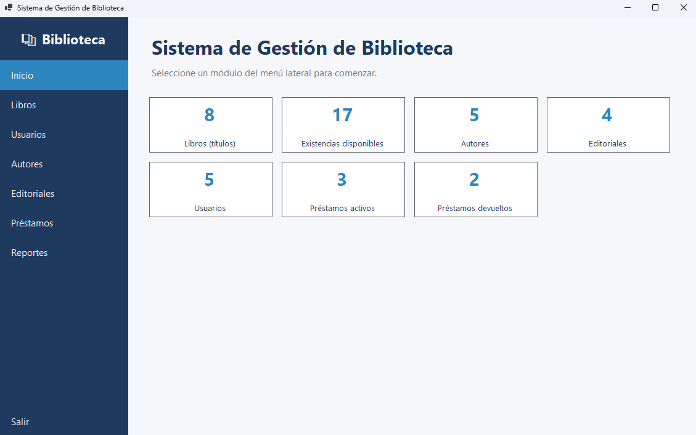
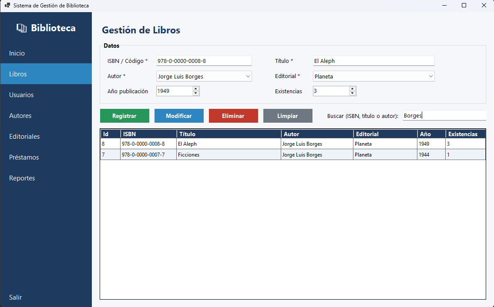
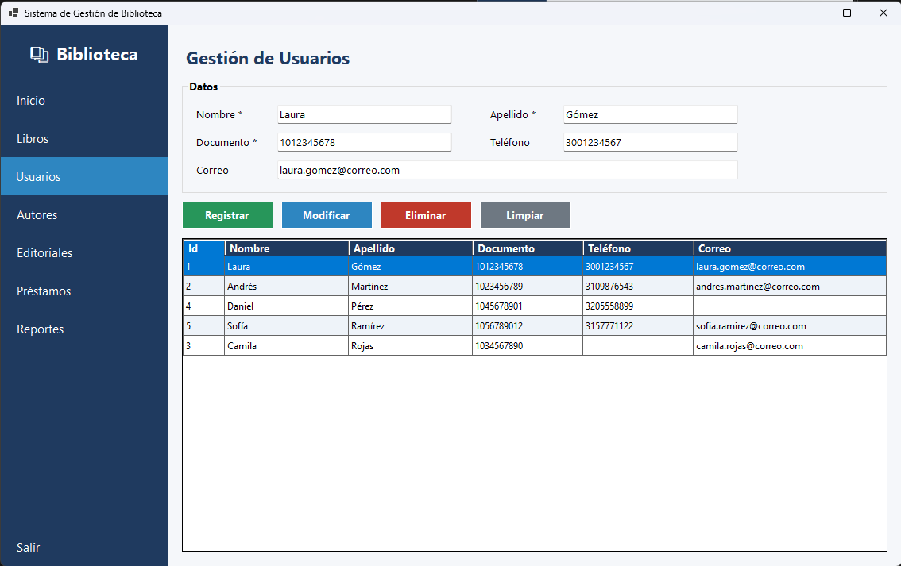
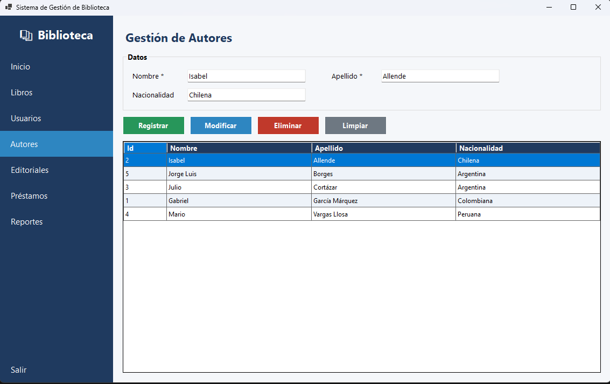
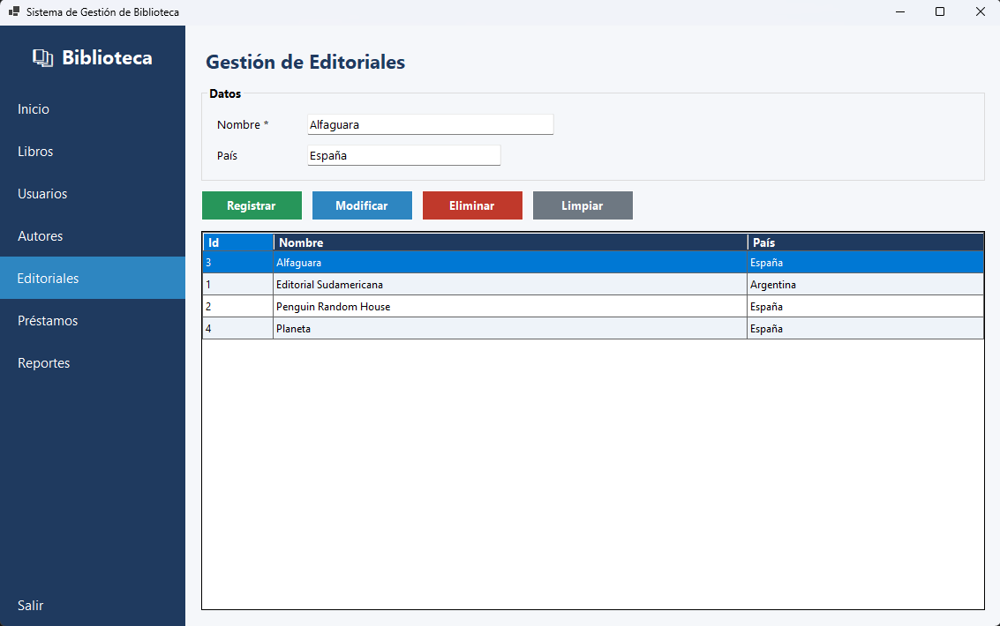
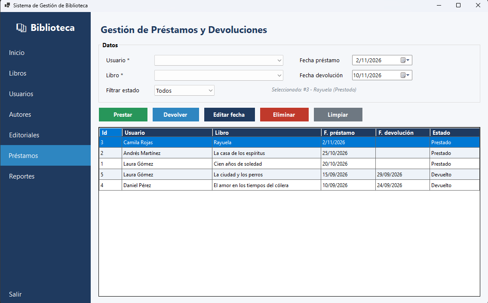
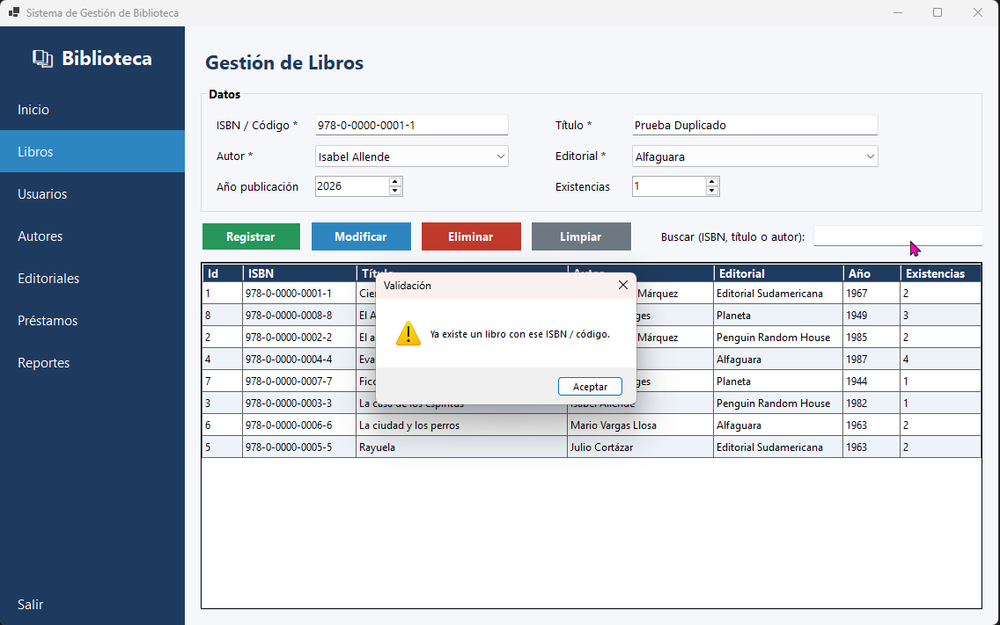

# Sistema de Gestión de Biblioteca

Aplicación de escritorio en **C# (.NET 8) + Windows Forms + SQL Server** para administrar libros, autores, editoriales, usuarios, préstamos y devoluciones, con reportes consolidados.

Proyecto final – Programación Avanzada.

## Contenido del repositorio

```
SistemaBiblioteca/
├── SistemaBiblioteca.sln
├── SistemaBiblioteca/            # Proyecto de Visual Studio
│   ├── Models/                   # Entidades (POO: herencia, encapsulamiento, polimorfismo)
│   ├── Data/                     # Acceso a datos (ADO.NET, consultas parametrizadas)
│   ├── Business/                 # Lógica de negocio y validaciones
│   ├── UI/                       # Formularios Windows Forms
│   ├── App.config                # Cadena de conexión
│   └── Program.cs
├── database/
│   └── BibliotecaDB.sql          # Script: BD, tablas, restricciones, vista y datos de prueba
├── docs/
│   ├── Documentacion_Tecnica.md  # Documento técnico (entregable 14.1)
│   └── capturas/                 # Capturas de pantalla del sistema
└── README.md
```

## Requisitos

- Windows 10/11
- Visual Studio 2022 (carga de trabajo **Desarrollo de escritorio con .NET**) o el SDK de .NET 8
- SQL Server (Express, Developer o LocalDB) y SQL Server Management Studio (SSMS)

## Instrucciones de ejecución

1. **Clonar el repositorio**
   ```bash
   git clone <URL-DEL-REPOSITORIO>
   ```
2. **Crear la base de datos:** abra `database/BibliotecaDB.sql` en SSMS y ejecútelo completo (F5). Crea `BibliotecaDB`, las tablas, la vista `vw_PrestamosDetalle` y los datos de prueba. El script se puede re-ejecutar: reinicia la base.
3. **Configurar la conexión:** edite `SistemaBiblioteca/App.config` y ajuste `Server` a su instancia:

   | Instancia | Valor de `Server` |
   |---|---|
   | SQL Server Express | `localhost\SQLEXPRESS` (por defecto) |
   | Instancia predeterminada | `localhost` |
   | LocalDB | `(localdb)\MSSQLLocalDB` |

   Para autenticación SQL use: `Server=...;Database=BibliotecaDB;User Id=usuario;Password=clave;TrustServerCertificate=True;`
4. **Abrir** `SistemaBiblioteca.sln` en Visual Studio, restaurar paquetes NuGet (automático) y ejecutar con **F5**.

## Funcionalidades

- Formulario principal con menú lateral: Inicio, Libros, Usuarios, Autores, Editoriales, Préstamos y Reportes.
- CRUD completo de libros, autores, editoriales y usuarios.
- Búsqueda de libros por ISBN, título o autor.
- Préstamos y devoluciones con control de existencias (transaccional).
- 8 reportes consultables y exportables a CSV.
- Validaciones de campos obligatorios, longitudes, duplicados, correo, fechas y existencias.
- Manejo de excepciones con mensajes claros; consultas 100 % parametrizadas.

## Reglas de negocio principales

- No se elimina un autor, editorial, libro o usuario con registros relacionados.
- No se presta un libro sin existencias ni dos veces al mismo usuario mientras siga activo.
- Prestar descuenta una existencia; devolver (o eliminar un préstamo activo) la repone.
- Un préstamo `Prestado` no tiene fecha de devolución; uno `Devuelto` la tiene y es mayor o igual a la de préstamo (también validado con `CHECK` en la BD).

## Arquitectura

Arquitectura por capas dentro de un mismo proyecto (separación por carpetas y *namespaces*):

`UI (Windows Forms)` → `Business (Servicios)` → `Data (DAO)` → `SQL Server`

Detalles, diagramas, modelo E-R y diccionario de datos en [`docs/Documentacion_Tecnica.md`](docs/Documentacion_Tecnica.md).

## Capturas de pantalla

| Inicio | Libros |
|---|---|
|  |  |

| Usuarios | Autores |
|---|---|
|  |  |

| Editoriales | Préstamos |
|---|---|
|  |  |

Validación (ISBN duplicado):



## Autor

- **Nombre:** David Mateo Barrera Silva
- **Documento:** 1013119249
- **Curso:** Programación Avanzada
- **Docente:** Veronica Castro
- **Institución:** Corporación Unificada Nacional de Educación Superior (CUN)
