<div align="center">

# SISTEMA DE GESTIÓN DE BIBLIOTECA

**Documentación técnica**

Proyecto final – Programación Avanzada

<br>

**Estudiante:** _(nombre completo)_
**Código / Documento:** _(completar)_
**Docente:** _(nombre del docente)_
**Institución:** _(nombre de la institución)_

<br>

Facatativá, Cundinamarca – Colombia
Noviembre de 2026

</div>

<div style="page-break-after: always;"></div>

<div align="center">

**CONTRAPORTADA**

<br><br>

SISTEMA DE GESTIÓN DE BIBLIOTECA
Aplicación de escritorio desarrollada con C#, Windows Forms y SQL Server

<br>

Trabajo presentado como requisito del curso **Programación Avanzada**

<br>

_(Nombre del estudiante)_

<br>

_(Institución)_
_(Programa académico)_
2026

</div>

<div style="page-break-after: always;"></div>

## Tabla de contenido

1. [Introducción](#1-introducción)
2. [Objetivos](#2-objetivos)
3. [Planteamiento del problema](#3-planteamiento-del-problema)
4. [Análisis de requerimientos](#4-análisis-de-requerimientos)
5. [Casos de uso](#5-casos-de-uso)
6. [Diagrama de clases](#6-diagrama-de-clases)
7. [Modelo entidad-relación](#7-modelo-entidad-relación)
8. [Diccionario de datos](#8-diccionario-de-datos)
9. [Arquitectura del sistema](#9-arquitectura-del-sistema)
10. [Explicación de los módulos desarrollados](#10-explicación-de-los-módulos-desarrollados)
11. [Conexión con SQL Server](#11-conexión-con-sql-server)
12. [Capturas de pantalla](#12-capturas-de-pantalla)
13. [Pruebas de funcionamiento](#13-pruebas-de-funcionamiento)
14. [Conclusiones](#14-conclusiones)
15. [Recomendaciones](#15-recomendaciones)
16. [Referencias bibliográficas](#16-referencias-bibliográficas)

> **Numeración de páginas:** al exportar este documento a PDF o Word (por ejemplo con la extensión *Markdown PDF* de VS Code, Typora o Pandoc), active la numeración de páginas en el pie de página. Con Pandoc: `pandoc Documentacion_Tecnica.md -o Documentacion_Tecnica.docx` y luego *Insertar → Número de página* en Word.

<div style="page-break-after: always;"></div>

## 1. Introducción

Las bibliotecas de las instituciones educativas manejan información que crece de forma constante: catálogo de libros, autores, editoriales, usuarios y un flujo permanente de préstamos y devoluciones. Cuando este control se realiza de forma manual o en hojas de cálculo dispersas, aparecen duplicados, inconsistencias y dificultad para saber qué libros están disponibles o quién los tiene.

Este documento describe el diseño y la implementación del **Sistema de Gestión de Biblioteca**, una aplicación de escritorio construida con **C# y Windows Forms** sobre **.NET 8**, que almacena su información en una base de datos relacional **SQL Server**. El sistema aplica los principios de la Programación Orientada a Objetos, una arquitectura por capas (presentación, lógica de negocio, acceso a datos y base de datos), validaciones de los datos ingresados, manejo de excepciones y consultas parametrizadas.

El documento incluye el análisis de requerimientos, los casos de uso, el diagrama de clases, el modelo entidad-relación, el diccionario de datos, la explicación de cada módulo, la forma de conexión con SQL Server, las pruebas de funcionamiento, las conclusiones y las recomendaciones.

## 2. Objetivos

### 2.1 Objetivo general

Desarrollar una aplicación de escritorio para la gestión integral de una biblioteca utilizando C#, Windows Forms y SQL Server, que permita administrar libros, autores, editoriales y usuarios, gestionar préstamos y devoluciones, y generar reportes mediante operaciones conectadas a una base de datos relacional, aplicando los principios de la Programación Orientada a Objetos.

### 2.2 Objetivos específicos

- Aplicar los principios de Programación Orientada a Objetos (clases, objetos, constructores, encapsulamiento, herencia y polimorfismo).
- Diseñar una base de datos relacional normalizada con claves primarias, foráneas y restricciones de integridad.
- Implementar operaciones CRUD para libros, autores, editoriales, usuarios y préstamos.
- Utilizar SQL Server como gestor de base de datos.
- Implementar una arquitectura por capas con separación de responsabilidades.
- Validar la información ingresada por el usuario y manejar excepciones.
- Utilizar Git y GitHub como sistema de control de versiones.
- Documentar técnicamente el proyecto.
- Implementar formularios para administrar libros, autores, editoriales y usuarios.

## 3. Planteamiento del problema

Una institución educativa requiere administrar los procesos de su biblioteca: registrar y consultar el material bibliográfico, mantener los datos de autores, editoriales y usuarios, controlar los préstamos y devoluciones, y consultar reportes. Sin un sistema centralizado se presentan problemas como:

- Información duplicada o inconsistente entre libros, autores y editoriales.
- Imposibilidad de conocer en tiempo real la disponibilidad de un libro.
- Préstamos sin seguimiento de su estado (prestado o devuelto).
- Dificultad para consultar el historial de préstamos de un usuario o de un libro.

La solución propuesta es una aplicación de escritorio que centralice los datos en SQL Server, garantice su integridad mediante restricciones y validaciones, y ofrezca una interfaz clara para las operaciones diarias.

## 4. Análisis de requerimientos

### 4.1 Requerimientos funcionales

| Código | Requerimiento | Módulo / formulario |
|---|---|---|
| RF01 | Gestión de libros: registrar, listar, editar, eliminar, buscar por ISBN, título o autor, relacionar con autor y editorial, consultar existencias | `LibrosForm` |
| RF02 | Gestión de autores: registrar, listar, editar y eliminar (si no tienen libros) | `AutoresForm` |
| RF03 | Gestión de editoriales: registrar, listar, editar y eliminar (si no tienen libros) | `EditorialesForm` |
| RF04 | Gestión de usuarios: registrar, listar, editar y eliminar (si no tienen préstamos) | `UsuariosForm` |
| RF05 | Gestión de préstamos: registrar, listar, editar fecha, eliminar, consultar estado | `PrestamosForm` |
| RF06 | Gestión de devoluciones: actualizar estado a «Devuelto», fecha de devolución y existencias | `PrestamosForm` |
| RF07 | Consultas y reportes (8 reportes) con exportación a CSV | `ReportesForm` |
| RF08 | Navegación mediante formulario principal | `MainForm` |

### 4.2 Requerimientos no funcionales

| Código | Requerimiento | Cómo se cumple |
|---|---|---|
| RNF01 | Interfaz clara y organizada | Menú lateral, formularios con la misma estructura (datos, botones, grilla) |
| RNF02 | Validación de campos obligatorios | Capa de negocio (`Validador`) y marcas `*` en la interfaz |
| RNF03 | Prevención de duplicados | Restricciones `UNIQUE` en BD y verificación previa en la capa de negocio |
| RNF04 | Mensajes claros | `UiHelper.Info/Advertencia/Error` |
| RNF05 | Manejo de excepciones | `UiHelper.Ejecutar` centraliza `ReglaNegocioException`, `SqlException` y excepciones generales |
| RNF06 | Código legible con nombres descriptivos | Convenciones de C#, clases por responsabilidad |
| RNF07 | Integridad de datos | Claves foráneas, `CHECK`, transacciones |
| RNF08 | Consultas parametrizadas | Todos los DAO usan `SqlCommand.Parameters` |
| RNF09 | Separación de responsabilidades | Capas `Models`, `Data`, `Business`, `UI` |

### 4.3 Reglas de negocio

1. Un libro debe tener un autor y una editorial existentes.
2. El ISBN es único; el documento del usuario es único; el nombre de editorial es único; la pareja nombre-apellido del autor es única.
3. No se puede prestar un libro sin existencias.
4. Un usuario no puede tener dos préstamos activos del mismo libro.
5. Prestar descuenta una existencia; devolver la repone.
6. La fecha de devolución no puede ser anterior a la del préstamo ni futura.
7. Un préstamo en estado *Prestado* no tiene fecha de devolución; en estado *Devuelto* sí la tiene.
8. No se eliminan autores, editoriales, libros o usuarios con registros relacionados.

## 5. Casos de uso

**Actor principal:** Bibliotecario (administrador del sistema).

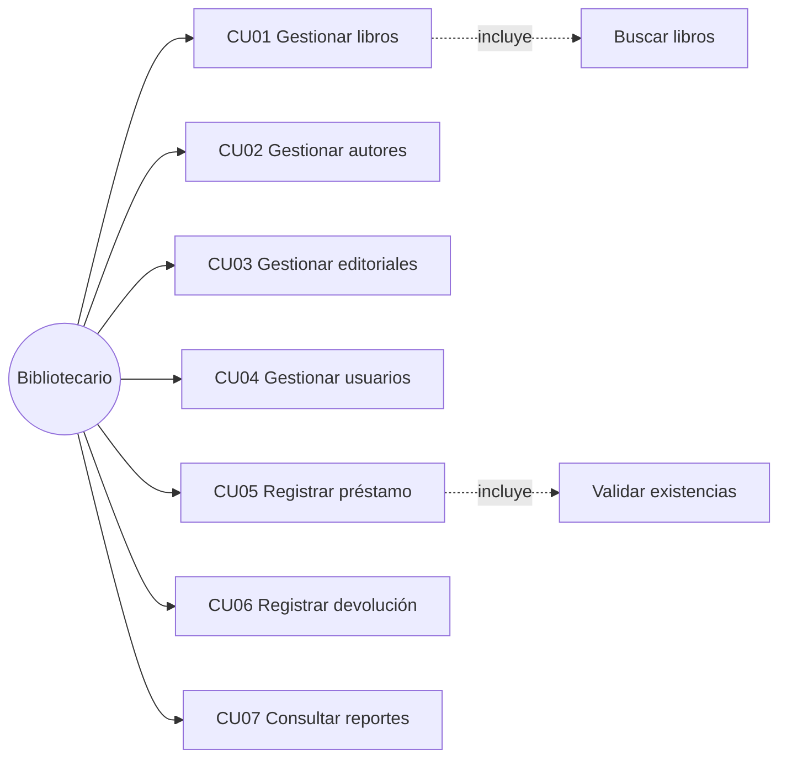

### CU01 – Gestionar libros

| Campo | Descripción |
|---|---|
| Actor | Bibliotecario |
| Precondición | La aplicación está conectada a la base de datos; existen autores y editoriales |
| Flujo principal | 1. Abre el módulo Libros. 2. Diligencia ISBN, título, autor, editorial, año y existencias. 3. Pulsa *Registrar*. 4. El sistema valida y guarda. 5. Muestra confirmación y actualiza la lista |
| Flujos alternos | *Modificar:* selecciona un libro de la grilla, edita y pulsa *Modificar*. *Eliminar:* selecciona y confirma. *Buscar:* escribe ISBN, título o autor y pulsa *Buscar* |
| Excepciones | ISBN duplicado, campos vacíos, año inválido, libro con préstamos asociados (no se elimina) |
| Postcondición | El catálogo queda actualizado |

### CU02, CU03, CU04 – Gestionar autores, editoriales y usuarios

Siguen el mismo flujo que CU01 (registrar, consultar, modificar, eliminar).
Excepciones propias: autor con el mismo nombre y apellido; editorial con nombre repetido; usuario con documento repetido o correo con formato inválido; eliminación bloqueada si existen libros (autor/editorial) o préstamos (usuario).

### CU05 – Registrar préstamo

| Campo | Descripción |
|---|---|
| Actor | Bibliotecario |
| Precondición | Existen usuarios y libros con existencias |
| Flujo principal | 1. Abre Préstamos. 2. Selecciona usuario y libro. 3. Define la fecha del préstamo. 4. Pulsa *Prestar*. 5. El sistema valida existencias, descuenta una unidad y registra el préstamo en estado *Prestado* (en una transacción) |
| Excepciones | Usuario o libro no seleccionado, libro sin existencias, préstamo activo duplicado, fecha futura |
| Postcondición | Préstamo registrado; existencias del libro disminuidas |

### CU06 – Registrar devolución

| Campo | Descripción |
|---|---|
| Actor | Bibliotecario |
| Precondición | Existe un préstamo en estado *Prestado* |
| Flujo principal | 1. Selecciona el préstamo en la grilla. 2. Define la fecha de devolución. 3. Pulsa *Devolver*. 4. El sistema cambia el estado a *Devuelto*, guarda la fecha y suma una existencia al libro (transacción) |
| Excepciones | Préstamo ya devuelto, fecha anterior al préstamo, fecha futura |
| Postcondición | Préstamo devuelto; existencias repuestas |

### CU07 – Consultar reportes

El bibliotecario elige un reporte de la lista, pulsa *Generar* y visualiza los resultados en la grilla; puede exportarlos a CSV.

## 6. Diagrama de clases

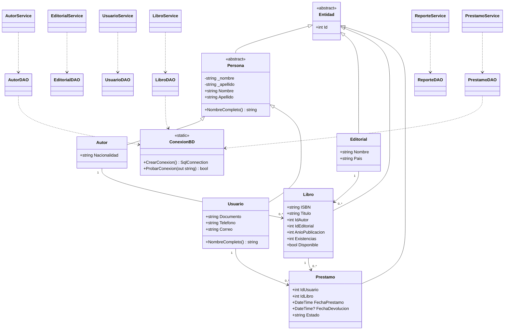

**Conceptos de POO aplicados**

| Concepto | Dónde se evidencia |
|---|---|
| Clases y objetos | `Libro`, `Autor`, `Usuario`, `Editorial`, `Prestamo` y los servicios/DAO |
| Constructores | `Autor(id, nombre, apellido, nacionalidad)`, `Usuario(...)`, `Editorial(...)` y constructores sin parámetros |
| Encapsulamiento | Campos privados `_nombre` y `_apellido` en `Persona` con propiedades que limpian espacios |
| Propiedades | Todas las entidades; `Libro.Disponible` es calculada |
| Métodos | `NombreCompleto()`, métodos CRUD de DAO y servicios |
| Colecciones | `List<T>` en listados, `Dictionary<string,string>` en el catálogo de reportes |
| Herencia | `Entidad` → `Persona` → `Autor`/`Usuario`; `Entidad` → `Editorial`, `Libro`, `Prestamo` |
| Polimorfismo | `NombreCompleto()` virtual; `Usuario` lo sobrescribe para incluir el documento y así se muestra en los `ComboBox` |
| Responsabilidad única | Cada capa y clase tiene una función definida |

## 7. Modelo entidad-relación

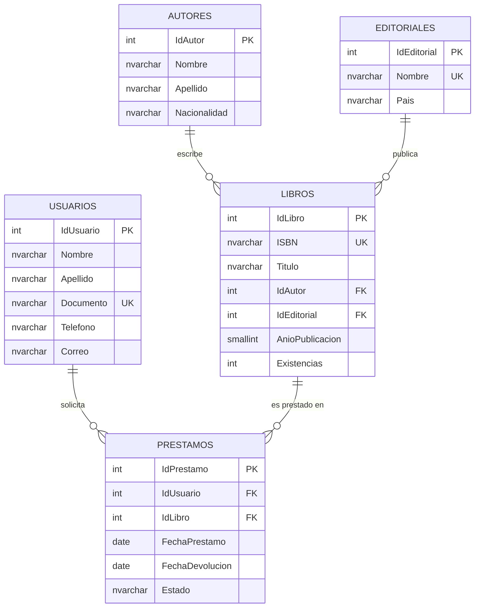

**Decisiones de diseño**

- Un libro tiene **un** autor principal y **una** editorial (relación 1:N). Si se requirieran coautores se agregaría una tabla intermedia `LibroAutor`.
- Cada préstamo corresponde a **un** libro, por lo que **no se requiere** una tabla `DetallePrestamos`.
- La vista `vw_PrestamosDetalle` une préstamos, usuarios y libros para simplificar consultas y reportes.

## 8. Diccionario de datos

### 8.1 Tabla `Autores`

| Campo | Tipo | Nulo | Clave / restricción | Descripción |
|---|---|---|---|---|
| IdAutor | INT IDENTITY | No | PK | Identificador del autor |
| Nombre | NVARCHAR(60) | No | UQ (Nombre, Apellido) | Nombre del autor |
| Apellido | NVARCHAR(60) | No | UQ (Nombre, Apellido) | Apellido del autor |
| Nacionalidad | NVARCHAR(60) | Sí | — | País de origen |

### 8.2 Tabla `Editoriales`

| Campo | Tipo | Nulo | Clave / restricción | Descripción |
|---|---|---|---|---|
| IdEditorial | INT IDENTITY | No | PK | Identificador de la editorial |
| Nombre | NVARCHAR(100) | No | UQ | Nombre de la editorial |
| Pais | NVARCHAR(60) | Sí | — | País de la editorial |

### 8.3 Tabla `Usuarios`

| Campo | Tipo | Nulo | Clave / restricción | Descripción |
|---|---|---|---|---|
| IdUsuario | INT IDENTITY | No | PK | Identificador del usuario |
| Nombre | NVARCHAR(60) | No | — | Nombre |
| Apellido | NVARCHAR(60) | No | — | Apellido |
| Documento | NVARCHAR(20) | No | UQ | Documento de identidad |
| Telefono | NVARCHAR(20) | Sí | — | Teléfono de contacto |
| Correo | NVARCHAR(100) | Sí | — | Correo electrónico (formato validado en la aplicación) |

### 8.4 Tabla `Libros`

| Campo | Tipo | Nulo | Clave / restricción | Descripción |
|---|---|---|---|---|
| IdLibro | INT IDENTITY | No | PK | Identificador del libro |
| ISBN | NVARCHAR(20) | No | UQ | Código ISBN |
| Titulo | NVARCHAR(200) | No | Índice | Título |
| IdAutor | INT | No | FK → Autores | Autor del libro |
| IdEditorial | INT | No | FK → Editoriales | Editorial del libro |
| AnioPublicacion | SMALLINT | No | CHECK 1000–2100 | Año de publicación |
| Existencias | INT | No | CHECK ≥ 0, DEFAULT 1 | Ejemplares disponibles |

### 8.5 Tabla `Prestamos`

| Campo | Tipo | Nulo | Clave / restricción | Descripción |
|---|---|---|---|---|
| IdPrestamo | INT IDENTITY | No | PK | Identificador del préstamo |
| IdUsuario | INT | No | FK → Usuarios | Usuario que recibe el libro |
| IdLibro | INT | No | FK → Libros | Libro prestado |
| FechaPrestamo | DATE | No | DEFAULT fecha actual | Fecha del préstamo |
| FechaDevolucion | DATE | Sí | CHECK de coherencia | Fecha de devolución |
| Estado | NVARCHAR(10) | No | CHECK ('Prestado','Devuelto') | Estado del préstamo |

**Restricción de coherencia (`CK_Prestamos_Coherencia`):** si el estado es *Prestado*, `FechaDevolucion` debe ser nula; si es *Devuelto*, debe tener valor y ser mayor o igual a `FechaPrestamo`.

### 8.6 Vista `vw_PrestamosDetalle`

Columnas: IdPrestamo, IdUsuario, Usuario (nombre completo), Documento, IdLibro, Libro, ISBN, FechaPrestamo, FechaDevolucion, Estado.

## 9. Arquitectura del sistema

El proyecto está organizado en **capas lógicas** dentro de un mismo proyecto de Visual Studio, separadas por carpetas y espacios de nombres. Cada capa solo se comunica con la inmediatamente inferior.

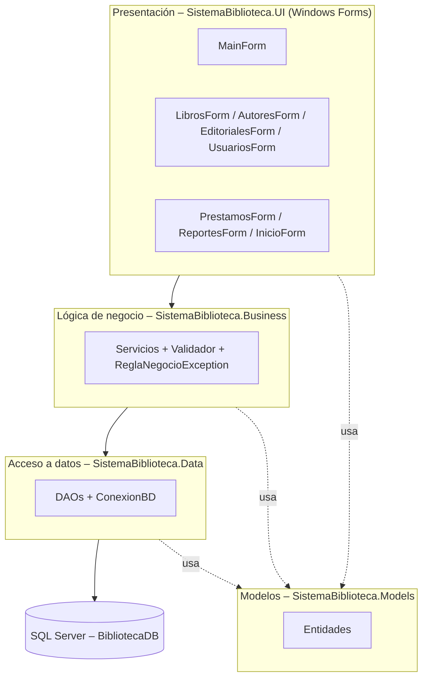

| Capa | Carpeta | Responsabilidad |
|---|---|---|
| Presentación | `UI/` | Formularios, controles, captura de datos, mensajes y resultados. No contiene SQL |
| Lógica de negocio | `Business/` | Validaciones, reglas del sistema, coordinación de procesos, traducción de errores de SQL a mensajes comprensibles |
| Acceso a datos | `Data/` | Conexión, consultas parametrizadas, transacciones |
| Modelos | `Models/` | Entidades de dominio (POO) |
| Base de datos | `database/` | Tablas, claves, restricciones y vista |

> **Nota (alineada con el enunciado):** las capas están separadas lógicamente (carpetas y *namespaces*) y no en proyectos independientes. Si el docente exige separación física, cada carpeta puede convertirse en una biblioteca de clases (`.Models`, `.Data`, `.Business`) referenciada por el proyecto de interfaz.

**Estructura de archivos**

```
SistemaBiblioteca/
├── Models/Entidades.cs
├── Data/ConexionBD.cs, DAOs.cs
├── Business/Servicios.cs
├── UI/UiHelper.cs, MainForm.cs, FormsMantenimiento.cs,
│      FormsLibrosPrestamos.cs, FormsReportesInicio.cs
├── App.config
└── Program.cs
```

## 10. Explicación de los módulos desarrollados

### 10.1 Inicio (`InicioForm`)
Pantalla de bienvenida con tarjetas de resumen (títulos, existencias, autores, editoriales, usuarios, préstamos activos y devueltos) obtenidas del reporte «Resumen consolidado».

### 10.2 Libros (`LibrosForm`, `LibroService`, `LibroDAO`)
CRUD de libros con `ComboBox` de autor y editorial, `NumericUpDown` para año y existencias, y búsqueda por ISBN, título o autor. La consulta une `Libros`, `Autores` y `Editoriales` para mostrar nombres en la grilla. Validaciones: campos obligatorios, longitudes, existencia de autor y editorial, año entre 1000 y el año actual, existencias no negativas, ISBN único.

### 10.3 Autores (`AutoresForm`, `AutorService`, `AutorDAO`)
CRUD de autores. Impide duplicar nombre y apellido y bloquea la eliminación si el autor tiene libros.

### 10.4 Editoriales (`EditorialesForm`, `EditorialService`, `EditorialDAO`)
CRUD de editoriales. Impide nombres repetidos y bloquea la eliminación si tiene libros.

### 10.5 Usuarios (`UsuariosForm`, `UsuarioService`, `UsuarioDAO`)
CRUD de usuarios. Valida documento obligatorio y único (solo letras y números), formato de correo con expresión regular, teléfono con caracteres permitidos y longitudes. Bloquea la eliminación si el usuario tiene préstamos.

### 10.6 Préstamos y devoluciones (`PrestamosForm`, `PrestamoService`, `PrestamoDAO`)
- **Prestar:** valida usuario y libro existentes, fecha no futura, existencias y préstamo activo duplicado. En una transacción descuenta la existencia (`UPDATE ... WHERE Existencias > 0`) e inserta el préstamo.
- **Devolver:** en una transacción actualiza estado y fecha y repone la existencia.
- **Editar fecha:** permite corregir la fecha del préstamo; usuario y libro no se editan para no desajustar las existencias.
- **Eliminar:** si el préstamo estaba activo, repone la existencia.
- **Filtro** por estado (Todos / Prestado / Devuelto).

### 10.7 Reportes (`ReportesForm`, `ReporteService`)
Reportes disponibles: Listado de libros, Listado de autores, Listado de editoriales, Listado de usuarios, Préstamos activos, Préstamos devueltos, Historial de préstamos y Resumen consolidado. Los resultados se muestran en un `DataGridView` y se pueden exportar a CSV (UTF-8, separador `;`).

### 10.8 Formulario principal (`MainForm`)
Menú lateral con los módulos y área de contenido donde se incrusta cada formulario. Al iniciar prueba la conexión y avisa si SQL Server no está disponible.

### 10.9 Manejo de excepciones
`UiHelper.Ejecutar` envuelve cada acción de la interfaz: `ReglaNegocioException` se muestra como advertencia, `SqlException` como error de base de datos con indicaciones, y cualquier otra excepción como error inesperado. Los servicios traducen los errores de SQL Server 547 (clave foránea) y 2627/2601 (duplicado) a mensajes claros.

## 11. Conexión con SQL Server

La conexión usa **ADO.NET** con el paquete `Microsoft.Data.SqlClient`. La cadena de conexión se guarda en `App.config`:

```xml
<connectionStrings>
  <add name="BibliotecaDB"
       connectionString="Server=localhost\SQLEXPRESS;Database=BibliotecaDB;Integrated Security=True;TrustServerCertificate=True;"
       providerName="Microsoft.Data.SqlClient" />
</connectionStrings>
```

La clase `ConexionBD` lee la cadena con `ConfigurationManager` y entrega conexiones nuevas; cada operación abre y cierra su conexión con `using`. Ejemplo de consulta parametrizada:

```csharp
using var cn = ConexionBD.CrearConexion();
using var cmd = new SqlCommand(
    "SELECT COUNT(1) FROM Usuarios WHERE Documento=@D AND IdUsuario<>@Id", cn);
cmd.Parameters.AddWithValue("@D", documento);
cmd.Parameters.AddWithValue("@Id", idExcluir);
cn.Open();
return (int)cmd.ExecuteScalar() > 0;
```

Las operaciones que modifican varias tablas (prestar, devolver, eliminar préstamo) usan `SqlTransaction` con `Commit`/`Rollback`, garantizando que préstamo y existencias nunca queden desincronizados. Los parámetros evitan la inyección SQL.

**Script SQL:** `database/BibliotecaDB.sql` crea la base de datos, las tablas, claves primarias y foráneas, restricciones `UNIQUE` y `CHECK`, índices, la vista `vw_PrestamosDetalle` y los datos de prueba (5 autores, 4 editoriales, 5 usuarios, 8 libros y 5 préstamos).

## 12. Capturas de pantalla

> Ejecute la aplicación, tome las capturas y guárdelas en `docs/capturas/` con los nombres indicados. Si exporta este documento, las imágenes se incluirán automáticamente.

| Pantalla | Archivo |
|---|---|
| Inicio con resumen | 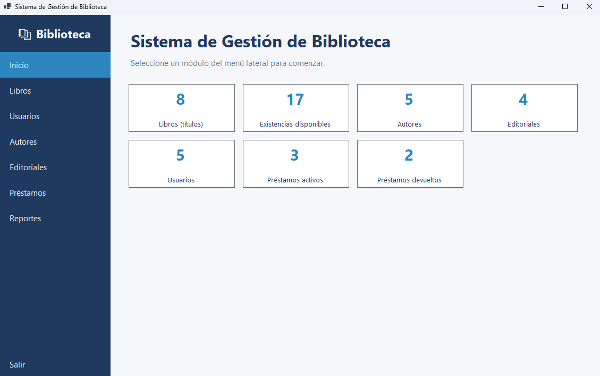 |
| Módulo Libros | 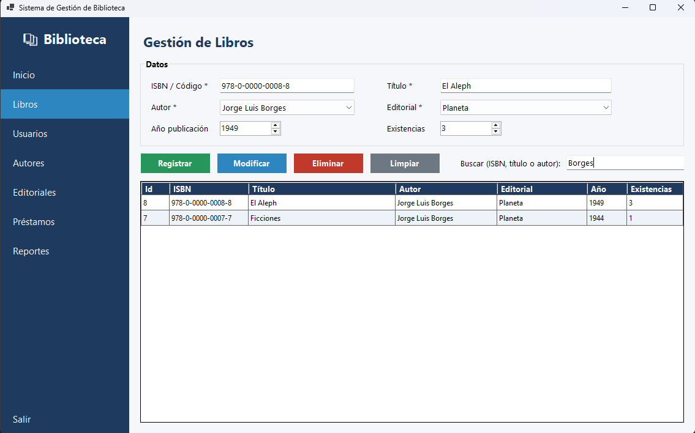 |
| Módulo Usuarios | 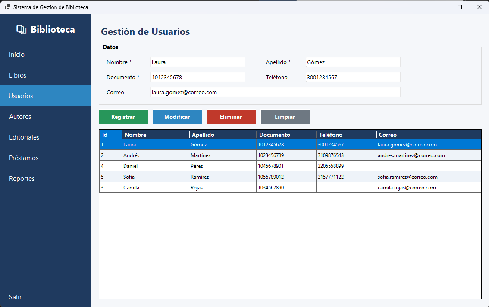 |
| Módulo Autores | 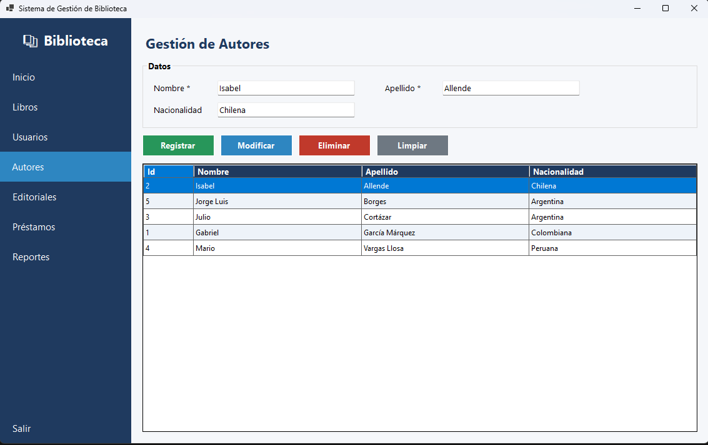 |
| Módulo Editoriales | 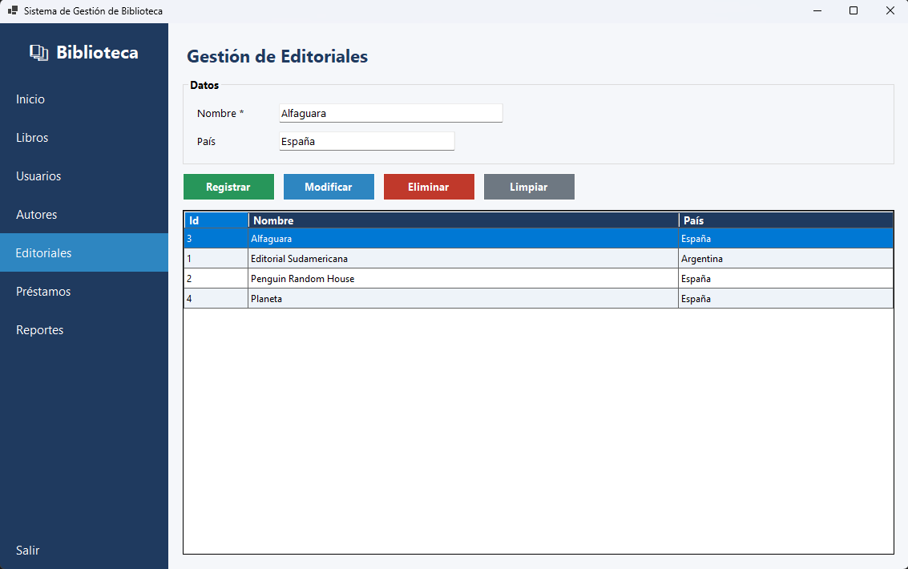 |
| Módulo Préstamos | 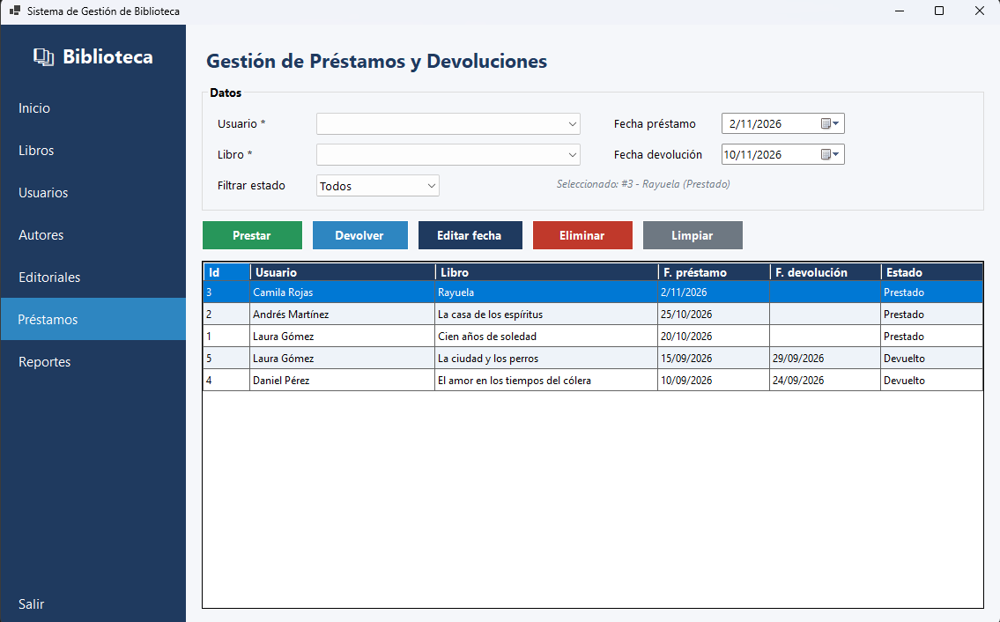 |
| Módulo Reportes | 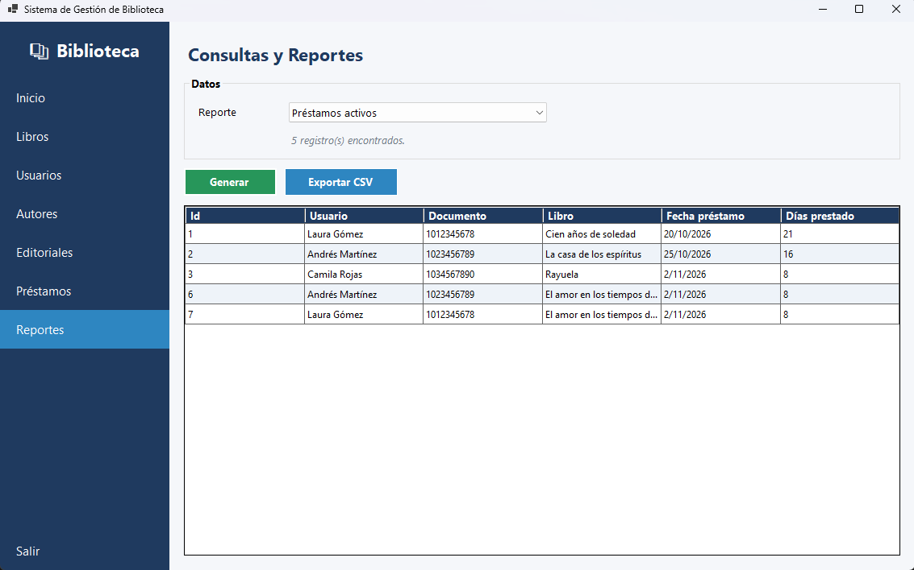 |
| Mensaje de validación (ej. ISBN duplicado) | 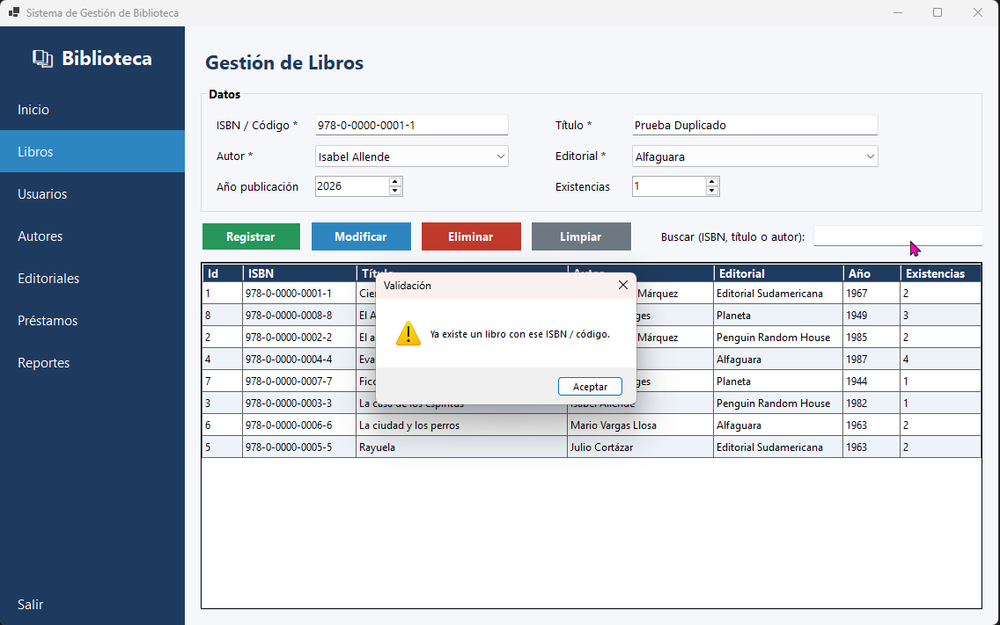 |
| Base de datos en SSMS | 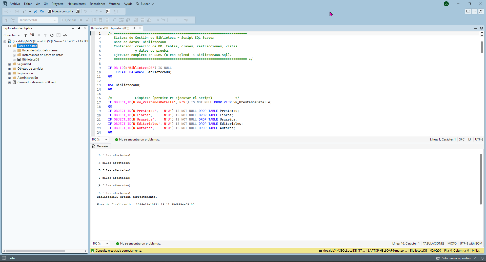 |

## 13. Pruebas de funcionamiento

Plan de pruebas funcionales. Complete la columna **Resultado obtenido** (✔ / ✘ y observaciones) al ejecutar cada caso con los datos de prueba del script.

| N.º | Módulo | Caso de prueba | Datos de entrada | Resultado esperado | Resultado obtenido |
|---|---|---|---|---|---|
| P01 | Autores | Registrar autor válido | Nombre «Laura», Apellido «Restrepo» | Mensaje de éxito; aparece en la grilla | |
| P02 | Autores | Registrar autor sin nombre | Nombre vacío | Advertencia «El campo 'Nombre' es obligatorio» | |
| P03 | Autores | Autor duplicado | «Isabel» «Allende» | Advertencia de autor existente | |
| P04 | Autores | Eliminar autor con libros | «Gabriel García Márquez» | Advertencia: tiene libros registrados | |
| P05 | Editoriales | Registrar editorial válida | «Editorial Norma», «Colombia» | Registro exitoso | |
| P06 | Editoriales | Nombre duplicado | «Planeta» | Advertencia de duplicado | |
| P07 | Usuarios | Registrar usuario válido | Datos completos y documento nuevo | Registro exitoso | |
| P08 | Usuarios | Documento duplicado | «1012345678» | Advertencia de documento existente | |
| P09 | Usuarios | Correo inválido | «correo-sin-arroba» | Advertencia de formato de correo | |
| P10 | Usuarios | Eliminar usuario con préstamos | «Laura Gómez» | Advertencia: tiene préstamos | |
| P11 | Libros | Registrar libro válido | ISBN nuevo, título, autor, editorial, 2020, 3 | Registro exitoso | |
| P12 | Libros | ISBN duplicado | «978-0-0000-0001-1» | Advertencia de ISBN existente | |
| P13 | Libros | Sin autor seleccionado | Autor sin elegir | Advertencia «Seleccione un autor existente» | |
| P14 | Libros | Buscar por título | «Rayuela» | La grilla muestra solo ese libro | |
| P15 | Libros | Buscar por autor | «Borges» | Muestra «Ficciones» y «El Aleph» | |
| P16 | Libros | Modificar existencias | Cambiar de 3 a 5 | Valor actualizado | |
| P17 | Préstamos | Registrar préstamo válido | Usuario «Sofía Ramírez», libro «El Aleph», fecha hoy | Préstamo en estado Prestado; existencias del libro −1 | |
| P18 | Préstamos | Préstamo sin existencias | Libro con existencias 0 | No aparece en el combo / advertencia | |
| P19 | Préstamos | Préstamo duplicado activo | Mismo usuario y libro activo | Advertencia de préstamo activo | |
| P20 | Préstamos | Registrar devolución | Seleccionar préstamo activo y pulsar *Devolver* | Estado Devuelto, fecha asignada, existencias +1 | |
| P21 | Préstamos | Devolver préstamo ya devuelto | Préstamo con estado Devuelto | Advertencia «ya fue devuelto» | |
| P22 | Préstamos | Fecha de devolución anterior al préstamo | Fecha menor | Advertencia de fecha inválida | |
| P23 | Préstamos | Eliminar préstamo activo | Seleccionar y confirmar | Se elimina; existencias +1 | |
| P24 | Préstamos | Filtrar por estado | «Devuelto» | Solo préstamos devueltos | |
| P25 | Reportes | Generar cada reporte | Seleccionar los 8 reportes | Cada uno muestra datos coherentes | |
| P26 | Reportes | Exportar a CSV | «Préstamos activos» | Archivo CSV creado y legible en Excel | |
| P27 | Conexión | SQL Server apagado | Detener el servicio | Mensaje claro de error de conexión | |

## 14. Conclusiones

- Se implementó una aplicación de escritorio que cubre los módulos de libros, autores, editoriales, usuarios, préstamos, devoluciones y reportes sobre una base de datos relacional en SQL Server.
- La arquitectura por capas separa la interfaz, las reglas de negocio y el acceso a datos, lo que facilita el mantenimiento y la ampliación del sistema.
- Las restricciones de la base de datos (`PRIMARY KEY`, `FOREIGN KEY`, `UNIQUE`, `CHECK`) combinadas con las validaciones de la capa de negocio garantizan la integridad y la consistencia de la información.
- El uso de transacciones en préstamos y devoluciones mantiene la coherencia entre el estado del préstamo y las existencias del libro.
- Las consultas parametrizadas protegen la aplicación contra la inyección SQL.
- La aplicación de herencia (`Entidad`, `Persona`), encapsulamiento y polimorfismo (`NombreCompleto`) evidencia los principios de la Programación Orientada a Objetos.
- El control de versiones con Git y GitHub permite documentar la evolución del proyecto mediante commits descriptivos.

## 15. Recomendaciones

- Agregar autenticación y roles (administrador, bibliotecario) con contraseñas almacenadas mediante *hash*.
- Incorporar fecha límite de devolución, cálculo de multas y alertas de préstamos vencidos.
- Soportar varios autores por libro mediante una tabla intermedia y manejar categorías o géneros.
- Separar físicamente las capas en proyectos independientes e incorporar pruebas unitarias sobre la capa de negocio.
- Migrar el acceso a datos a un ORM (Entity Framework Core) o a procedimientos almacenados.
- Generar reportes en PDF con gráficos y programar copias de seguridad de la base de datos.
- Registrar una bitácora de operaciones (auditoría).

## 16. Referencias bibliográficas

Chacon, S., & Straub, B. (2014). *Pro Git* (2.ª ed.). Apress. https://git-scm.com/book/es/v2

Martin, R. C. (2017). *Clean architecture: A craftsman's guide to software structure and design*. Prentice Hall.

Microsoft. (s. f.). *Documentación de Windows Forms*. Microsoft Learn. https://learn.microsoft.com/es-es/dotnet/desktop/winforms/

Microsoft. (s. f.). *Documentación de SQL Server*. Microsoft Learn. https://learn.microsoft.com/es-es/sql/sql-server/

Microsoft. (s. f.). *Guía de C#*. Microsoft Learn. https://learn.microsoft.com/es-es/dotnet/csharp/

Microsoft. (s. f.). *ADO.NET*. Microsoft Learn. https://learn.microsoft.com/es-es/dotnet/framework/data/adonet/

> Verifique las URL y agregue la fecha de consulta si su docente la exige. Incluya cualquier otra fuente que haya utilizado.
